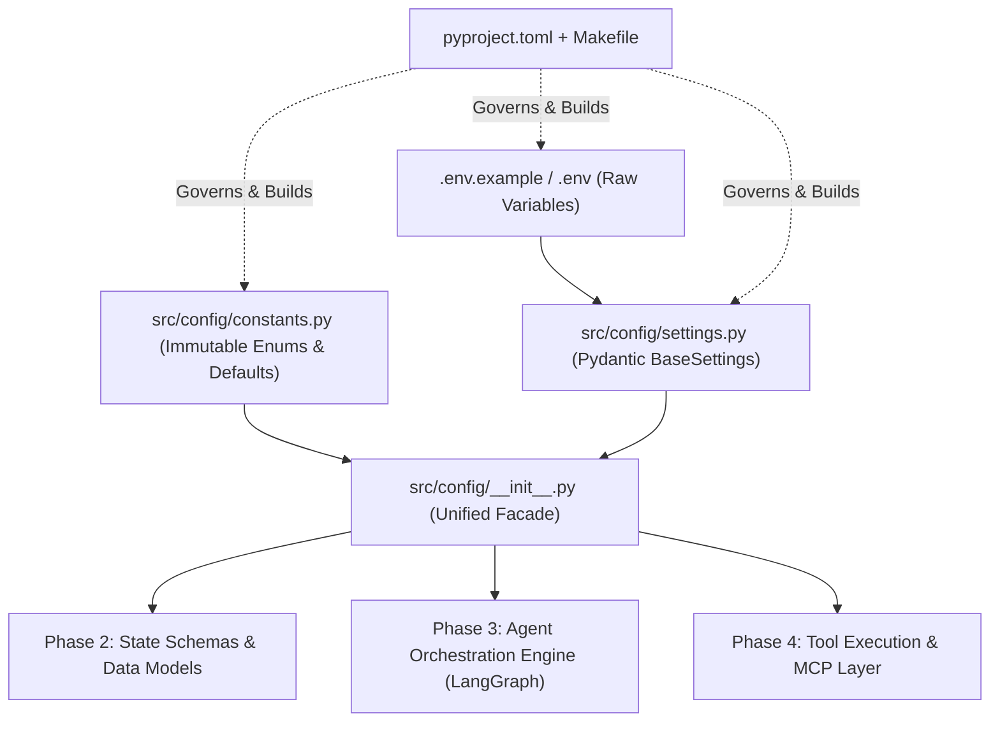
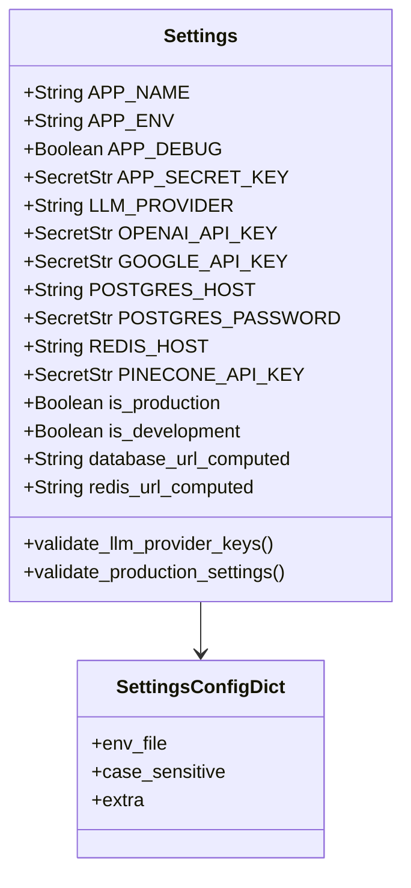
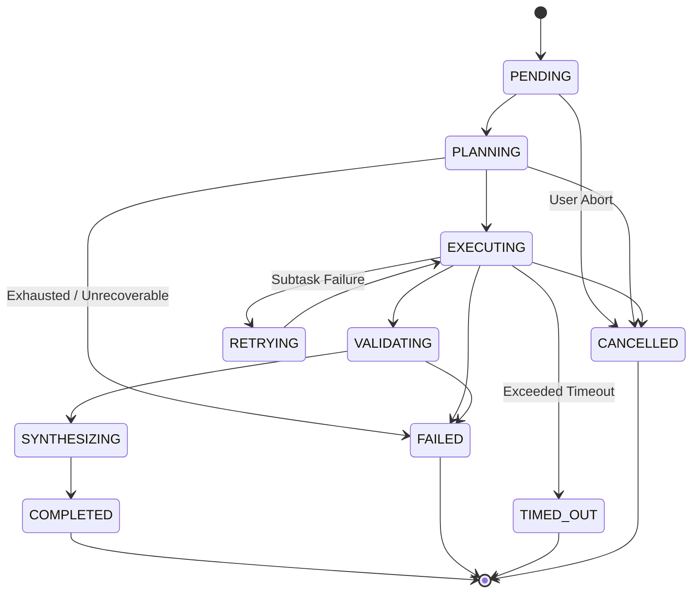

# Multi-Agent-Orchestration

Multi-Agent-Orchestration is a framework that enables the creation of multi-agent systems using AI.


## 1. Phase Overview & Strategic Placement

### 1.1 High-Level Summary of Phase 1 Accomplishments
Phase 1 established the foundational infrastructure, dependency management, configuration validation layer, and system-wide immutable constants for **DevAgent**, a distributed, fault-tolerant multi-agent orchestration system. Rather than jumping directly into high-level agent logic, Phase 1 focused on creating an airtight, production-grade foundation that guarantees strict type safety, zero-leak secrets management, predictable build environments, and decoupled configuration schemas.

Specifically, Phase 1 delivered:
1. **Repository Hygiene & Perimeter Security:** A hardened [`.gitignore`](file:///c:/Users/Teja/Downloads/Multi-Agent-Orchestration/.gitignore) shielding API tokens, credentials, caches, compiled binaries, vector store state, and MCP communication artifacts.
2. **Unified Secrets & Variable Schematization:** A comprehensive environment contract ([`.env.example`](file:///c:/Users/Teja/Downloads/Multi-Agent-Orchestration/.env.example) and [`.env`](file:///c:/Users/Teja/Downloads/Multi-Agent-Orchestration/.env)) detailing 11 distinct subsystem domains ranging from LLM multi-tenancy and fallback architectures to database pools, vector indices, and MCP transports.
3. **Modern Packaging & Toolchain Standard:** A declarative, PEP 621-compliant [`pyproject.toml`](file:///c:/Users/Teja/Downloads/Multi-Agent-Orchestration/pyproject.toml) structuring core, development, testing, and documentation dependencies alongside unified configurations for Ruff, Mypy, Pytest, and Coverage.
4. **Developer Ergonomics & Automation Engine:** A robust cross-platform [`Makefile`](file:///c:/Users/Teja/Downloads/Multi-Agent-Orchestration/Makefile) standardizing environment bootstrapping, incremental installs, server lifecycles, database migrations, Docker workflows, and static analysis checks.
5. **Clean Modular Packaging:** Structural initialization ([`src/__init__.py`](file:///c:/Users/Teja/Downloads/Multi-Agent-Orchestration/src/__init__.py) and [`src/config/__init__.py`](file:///c:/Users/Teja/Downloads/Multi-Agent-Orchestration/src/config/__init__.py)) enforcing strict namespace isolation and preventing circular dependency cycles.
6. **Strict Dynamic Configuration & Validation:** A Pydantic v2 [`Settings`](file:///c:/Users/Teja/Downloads/Multi-Agent-Orchestration/src/config/settings.py#L35-L345) singleton ([`src/config/settings.py`](file:///c:/Users/Teja/Downloads/Multi-Agent-Orchestration/src/config/settings.py)) that validates data types at runtime, enforces range boundaries, masks secrets with `SecretStr`, computes dynamic URLs (PostgreSQL async DSNs, Redis scheme formatting), and executes fail-fast startup checks.
7. **Deterministic Runtime State & Domain Enums:** An immutable constants module ([`src/config/constants.py`](file:///c:/Users/Teja/Downloads/Multi-Agent-Orchestration/src/config/constants.py)) codifying agent archetypes, state-machine lifecycles, priority matrices, token economics, system prompts, and standardized error schemas.
8. **Isolated Virtual Execution Environment:** A dedicated Python virtual environment (`.venv`) with managed dependencies installed in an incremental, staged approach to maintain lean iteration cycles.



---

### 1.2 Why Foundational Setup Must Precede Orchestrator and Agent Logic

In complex distributed agentic systems, writing agent logic prior to establishing operational and infrastructural foundations leads directly to catastrophic architectural debt. In a multi-agent network, autonomous LLM workers communicate asynchronously, manage shared state, query vector indices, invoke sandboxed execution environments, and interface with external Model Context Protocol (MCP) servers. The justifications for placing these steps first include:

* **Eliminating Silent Failures & Configuration Drift:** If an orchestrator begins dispatching subtasks to specialized agents (e.g., Research, Coding, Analysis) without strict upstream validation, missing API keys or malformed database DSNs manifest as cryptic mid-execution runtime exceptions. Pydantic-based fail-fast validation ensures that the system refuses to boot if critical credentials or hostnames are absent.
* **Deterministic Multi-Agent State Machine:** Agent coordination requires a finite state machine (FSM). Defining state transitions (`PENDING`, `PLANNING`, `EXECUTING`, `VALIDATING`, `SYNTHESIZING`, `COMPLETED`, `FAILED`, `RETRYING`) and priority ranking as typed enums up front prevents disparate agents from producing disjointed status strings.
* **Secrets Isolation & Enterprise Governance:** Multi-agent systems frequently log context, prompts, tool outputs, and execution traces. Using raw string configuration variables risks leaking high-privilege keys (OpenAI, Anthropic, Google, GitHub, Slack) into stdout, logs, or OpenTelemetry spans. Enforcing `SecretStr` at the root configuration layer guarantees masking across representations and loggers.
* **Consistent Async Runtime Substrates:** DevAgent utilizes modern asynchronous IO (`asyncio`, `asyncpg`, `httpx`, `websockets`, `redis.asyncio`). Establishing the dependency constraints and interpreter configuration (Python 3.11+) ensures that all database connection pooling, LLM streaming, and concurrent agent execution pipelines operate without event loop deadlocks.

---

## 2. Step-by-Step Execution Breakdown

### Step 2.1: Repository Perimeter & Artifact Isolation — [`.gitignore`](file:///c:/Users/Teja/Downloads/Multi-Agent-Orchestration/.gitignore)

* **Step/File Name:** [`.gitignore`](file:///c:/Users/Teja/Downloads/Multi-Agent-Orchestration/.gitignore)
* **Contribution & Purpose:** Establishes a comprehensive multi-layered exclusion boundary across 11 architectural domains. It guarantees that secrets (`.env`, `*.pem`, `*.key`), Python compilation artifacts (`__pycache__`, `.venv`, `.pytest_cache`, `.mypy_cache`), database dumps (`dump.rdb`, `*.sqlite3`), local monitoring data (`otel-exports/`, `prometheus-data/`), MCP server runtime state (`.mcp/`, `mcp-cache/`), and local vector/AI checkpoints (`.langgraph_checkpoints/`, `pinecone-data/`) are never leaked to version control. Importantly, it explicitly white-lists configuration blueprints such as [`.env.example`](file:///c:/Users/Teja/Downloads/Multi-Agent-Orchestration/.env.example) and future `mcp_config.json` specifications.
* **Timing Justification:** Required as Step 1.1 before any local development, secret creation, or package installation took place. Generating a `.env` file or building virtual environments prior to committing a `.gitignore` risks irreversible secret leaks or tracking large binary caches in the git history.

---

### Step 2.2: Environment Blueprint & Parameter Contract — [`.env.example`](file:///c:/Users/Teja/Downloads/Multi-Agent-Orchestration/.env.example) and [`.env`](file:///c:/Users/Teja/Downloads/Multi-Agent-Orchestration/.env)

* **Step/File Name:** [`.env.example`](file:///c:/Users/Teja/Downloads/Multi-Agent-Orchestration/.env.example) / [`.env`](file:///c:/Users/Teja/Downloads/Multi-Agent-Orchestration/.env)
* **Contribution & Purpose:** Acts as the explicit contract between the operating infrastructure and the application code. It documents every environment parameter across 11 discrete subsystem modules:
  1. *Application Core* (Host, Port, Debug, JWT signing keys, Auth keys)
  2. *LLM Providers & Fallback Strategy* (Google, OpenAI, Azure, Anthropic)
  3. *Relational Database Storage* (PostgreSQL host, credentials, pooling parameters)
  4. *In-Memory Shared State & Memory* (Redis host, port, DB index, TTLs)
  5. *Vector Database & Retrieval* (Pinecone environment, dimensions, embedding models)
  6. *Agent Tool Configurations* (Tavily search, GitHub personal access tokens, Docker sandbox execution constraints)
  7. *Model Context Protocol (MCP)* (Transport types, timeout, retries, auth tokens)
  8. *Telemetry & Observability* (OpenTelemetry endpoints, Prometheus scrapers, cost thresholds)
  9. *External Collaboration Webhooks* (Slack, Notion, GitHub webhooks)
  10. *Security & Rate Limiting* (Request rate limits, LLM token buckets, CORS)
  11. *Agent Pipeline Governance* (Concurrency limits, timeout bounds, retry ceilings)
* **Timing Justification:** Implemented immediately after `.gitignore`. In a twelve-factor application architecture, configuration must be decoupled from code. Creating the environment specification first forces explicit architectural boundaries before designing data models and settings parsers.

---

### Step 2.3: Modern Dependency Packaging & Static Tooling — [`pyproject.toml`](file:///c:/Users/Teja/Downloads/Multi-Agent-Orchestration/pyproject.toml)

* **Step/File Name:** [`pyproject.toml`](file:///c:/Users/Teja/Downloads/Multi-Agent-Orchestration/pyproject.toml)
* **Contribution & Purpose:** Replaces obsolete legacy packaging (`setup.py`, `requirements.txt`, `setup.cfg`) with the PEP 517/518/621 unified packaging specification. It defines:
  * Package metadata for `devagent`
  * Core dependencies required across the runtime lifecycle (LangGraph, FastAPI, Asyncpg, Redis, MCP SDK, OpenTelemetry)
  * Granular optional dependency sets (`dev`, `test`, `docs`) enabling minimal production container builds while accommodating rigorous local testing
  * Executable entrypoints (`devagent` pointing to [`src.api.main:run`](file:///c:/Users/Teja/Downloads/Multi-Agent-Orchestration/pyproject.toml#L148) and `devagent-mcp` pointing to [`src.mcp.server:run`](file:///c:/Users/Teja/Downloads/Multi-Agent-Orchestration/pyproject.toml#L149))
  * Unified configurations for Ruff (combining flake8, black, isort, bandit), Mypy (strict typing mode), Pytest (asyncio mode, custom test markers), and Coverage (80% failure threshold).
* **Timing Justification:** Placed prior to code creation. Modern Python projects require deterministic lock-ins of build backends (`setuptools.build_meta`) and tool rules before writing code so that IDE linters, language servers, and type checkers operate under identical static analysis parameters.

---

### Step 2.4: Unified Developer Automation Interface — [`Makefile`](file:///c:/Users/Teja/Downloads/Multi-Agent-Orchestration/Makefile)

* **Step/File Name:** [`Makefile`](file:///c:/Users/Teja/Downloads/Multi-Agent-Orchestration/Makefile)
* **Contribution & Purpose:** Bridges local developer operating system variability (Windows PowerShell, Linux bash, macOS zsh) with standardized engineering commands. Provides uniform targets for:
  * Environment initialization (`make install`, `make install-dev`, `make install-all`, `make clean`)
  * Application execution (`make run` with auto-reload, `make run-prod` with multiple uvicorn workers, `make mcp-server`)
  * Static code quality (`make lint`, `make format`, `make type-check`, `make check`)
  * Multi-tiered testing (`make test`, `make test-unit`, `make test-integration`, `make test-cov`)
  * Database operations (`make db-migrate`, `make db-upgrade`, `make db-seed`)
  * Container orchestration (`make docker-up`, `make docker-down`, `make docker-fresh`)
  * MCP tool introspection (`make mcp-discover`, `make mcp-list`)
* **Timing Justification:** Built before writing the configuration modules to eliminate command-line friction and human error. Every subsequent installation and validation command could be invoked via reproducible targets.

---

### Step 2.5: Root & Configuration Package Initialization — [`src/__init__.py`](file:///c:/Users/Teja/Downloads/Multi-Agent-Orchestration/src/__init__.py) & [`src/config/__init__.py`](file:///c:/Users/Teja/Downloads/Multi-Agent-Orchestration/src/config/__init__.py)

* **Step/File Name:** [`src/__init__.py`](file:///c:/Users/Teja/Downloads/Multi-Agent-Orchestration/src/__init__.py) and [`src/config/__init__.py`](file:///c:/Users/Teja/Downloads/Multi-Agent-Orchestration/src/config/__init__.py)
* **Contribution & Purpose:** Transforms the directories into standard Python packages.
  * [`src/__init__.py`](file:///c:/Users/Teja/Downloads/Multi-Agent-Orchestration/src/__init__.py) establishes package metadata (`__version__ = "0.1.0"`, `__app_name__ = "DevAgent"`) while deliberately keeping imports zero-weight to prevent cyclic dependency issues at the root.
  * [`src/config/__init__.py`](file:///c:/Users/Teja/Downloads/Multi-Agent-Orchestration/src/config/__init__.py) exposes a clean public interface via `__all__`, allowing all downstream modules to write concise imports (`from src.config import get_settings, AgentType, TaskStatus`) without reaching into internal module file paths.
* **Timing Justification:** Required as the directory scaffolding step before placing `settings.py` and `constants.py`. Without explicit package initialization, Python's import system cannot reliably resolve absolute imports across differing execution environments.

---

### Step 2.6: Type-Validated Dynamic Settings Engine — [`src/config/settings.py`](file:///c:/Users/Teja/Downloads/Multi-Agent-Orchestration/src/config/settings.py)

* **Step/File Name:** [`src/config/settings.py`](file:///c:/Users/Teja/Downloads/Multi-Agent-Orchestration/src/config/settings.py)
* **Contribution & Purpose:** Serves as the single source of truth for runtime configuration. Built on Pydantic v2's `BaseSettings`, it parses environment variables and `.env` files, casts them to strict types, enforces value boundaries via `Field()`, masks secrets with `SecretStr`, generates computed connection strings (`database_url_computed`, `redis_url_computed`), enforces provider-specific startup requirements (e.g., verifying that the active LLM provider has an API key configured), and provides an LRU-cached singleton accessor [`get_settings()`](file:///c:/Users/Teja/Downloads/Multi-Agent-Orchestration/src/config/settings.py#L350-L361).
* **Timing Justification:** Must precede all application layers. Every future component—from PostgreSQL connection pools in Phase 2 to LangGraph model instantiation in Phase 3—relies on reading validated configuration parameters from `settings.py`.

---

### Step 2.7: Deterministic Domain Enums & Global Constants — [`src/config/constants.py`](file:///c:/Users/Teja/Downloads/Multi-Agent-Orchestration/src/config/constants.py)

* **Step/File Name:** [`src/config/constants.py`](file:///c:/Users/Teja/Downloads/Multi-Agent-Orchestration/src/config/constants.py)
* **Contribution & Purpose:** Houses all static, immutable domain knowledge that does not depend on environment variables. Defines:
  * String-backed enumerations ([`AgentType`](file:///c:/Users/Teja/Downloads/Multi-Agent-Orchestration/src/config/constants.py#L24-L58), [`TaskStatus`](file:///c:/Users/Teja/Downloads/Multi-Agent-Orchestration/src/config/constants.py#L64-L108), [`SubTaskStatus`](file:///c:/Users/Teja/Downloads/Multi-Agent-Orchestration/src/config/constants.py#L114-L123), [`LLMProvider`](file:///c:/Users/Teja/Downloads/Multi-Agent-Orchestration/src/config/constants.py#L156-L174), [`MCPTransport`](file:///c:/Users/Teja/Downloads/Multi-Agent-Orchestration/src/config/constants.py#L180-L186), [`MCPToolSource`](file:///c:/Users/Teja/Downloads/Multi-Agent-Orchestration/src/config/constants.py#L189-L194))
  * Integer-ordered priority ([`Priority`](file:///c:/Users/Teja/Downloads/Multi-Agent-Orchestration/src/config/constants.py#L129-L150))
  * State transition metadata (`is_terminal`, `is_active`)
  * Agent role descriptions and default tool associations
  * System prompts for the Orchestrator, Research Agent, Coding Agent, and Analysis Agent
  * LLM token cost lookup matrices per million tokens for live expense tracking
  * Hardcoded API prefixes, cache key prefixes, and standardized error response dictionaries.
* **Timing Justification:** Final step of Phase 1. Complements `settings.py` by completing the configuration layer. Together, `settings.py` (dynamic variables) and `constants.py` (static invariants) resolve all dependencies required by [`src/config/__init__.py`](file:///c:/Users/Teja/Downloads/Multi-Agent-Orchestration/src/config/__init__.py) and prepare the ground for Phase 2 data modeling.

---

### Step 2.8: Virtual Environment Isolation & Incremental Dependency Strategy

* **Step/File Name:** Local `.venv` Creation & Staged Package Hydration
* **Contribution & Purpose:** Created an isolated execution environment using Python 3.11+, upgraded core packaging tooling (`pip`, `setuptools`, `wheel`), and resolved initial IDE language server errors by strategically installing foundational modules (`pydantic`, `pydantic-settings`, `python-dotenv`). Adopted an incremental dependency strategy to prevent long installation lockouts and ensure each phase's dependencies are verified in isolation.
* **Timing Justification:** Essential to validate that the configuration files actually parse and that IDE diagnostics (such as Pyright / Pylance import resolution) accurately confirm a healthy build.

---

## 3. Deep-Dive Code & Configuration Analysis

### 3.1 [`.gitignore`](file:///c:/Users/Teja/Downloads/Multi-Agent-Orchestration/.gitignore) Deep-Dive

#### Code Walkthrough
The [`.gitignore`](file:///c:/Users/Teja/Downloads/Multi-Agent-Orchestration/.gitignore) is divided into 11 strictly structured blocks, each with a clear operational scope:
* **Lines 11–20 (Secrets):** Ignores `.env`, `.env.local`, `.env.production`, and certificate extensions (`*.pem`, `*.key`, `*.crt`). Crucially, `.env.example` is left untracked by absence, ensuring the template is preserved while instances holding secrets are ignored.
* **Lines 26–75 (Python Caches & Artifacts):** Blocks `__pycache__/`, byte-code (`*.pyc`), packaging metadata (`*.egg-info/`, `build/`, `dist/`), test caches (`.pytest_cache/`, `.coverage`), and static analysis state (`.mypy_cache/`, `.ruff_cache/`).
* **Lines 142–155 (Databases):** Blocks local database files (`*.sqlite3`, `dump.rdb` from Redis, and PostgreSQL local data directories).
* **Lines 173–184 (Model Context Protocol):** Blocks `.mcp/`, `mcp-cache/`, and `.mcp_state/`. Comments explicitly stipulate that `mcp_config.json` must remain tracked because it contains declarative server topologies rather than credentials.
* **Lines 186–201 (AI & LLM Artifacts):** Blocks model weights (`*.gguf`, `*.safetensors`), local vector storage (`pinecone-data/`), and agent execution checkpoint directories (`.langgraph_checkpoints/`, `.langchain_cache/`).

#### Design Rationale
In multi-agent systems, agents frequently produce dynamic files during research, code generation, and sandboxed execution. Without proactive exclusion rules for checkpoints, local embeddings, and MCP runtime sockets, developers inadvertently commit megabytes of transient cache files and exposed credentials into git history.

---

### 3.2 [`.env.example`](file:///c:/Users/Teja/Downloads/Multi-Agent-Orchestration/.env.example) Deep-Dive

#### Code Walkthrough & Section Rationale
* **Application (Lines 15–28):** Configures application bindings (`APP_HOST=0.0.0.0`, `APP_PORT=8000`). Maps `APP_SECRET_KEY` with an explicit notice to replace the default value, and provides `APP_API_KEYS` for client authentication headers.
* **LLM Providers (Lines 34–62):** Supports multi-provider routing:
  ```bash
  LLM_PROVIDER=openai
  LLM_MODEL=gpt-4o
  LLM_TEMPERATURE=0.1
  LLM_MAX_TOKENS=4096
  LLM_REQUEST_TIMEOUT=60
  ```
  Isolates credentials for OpenAI, Azure OpenAI (endpoint, api version, deployment), Anthropic, and Google AI. Introduces dedicated parameters for a fallback LLM to provide automated failover if the primary model rate-limits.
* **Persistence & Caching (Lines 67–100):** Defines connection endpoints for PostgreSQL (port `5432`) and Redis (port `6379`), including pool parameters (`POSTGRES_POOL_SIZE=10`, `POSTGRES_MAX_OVERFLOW=20`) and cache TTLs (`REDIS_DEFAULT_TTL=3600`, `REDIS_SESSION_TTL=86400`).
* **Vector Store & Embeddings (Lines 104–114):** Configures Pinecone (`PINECONE_INDEX_NAME=devagent-knowledge`, `PINECONE_DIMENSION=1536`, `PINECONE_METRIC=cosine`) paired with embedding provider specifications.
* **Agent Sandboxing & MCP (Lines 128–154):** Defines strict resource boundaries for dynamic code execution (`CODE_EXECUTOR_TIMEOUT=30`, `CODE_EXECUTOR_MAX_MEMORY_MB=256`, `CODE_EXECUTOR_DOCKER_IMAGE=python:3.12-slim`). Defines MCP discovery rules, client timeouts, retry thresholds, individual server auth tokens, and DevAgent’s own inbound MCP server parameters (`MCP_SERVER_PORT=8001`).
* **Governance & Rate Limits (Lines 198–229):** Implements dual-layer rate limiting: HTTP API rate limits (`RATE_LIMIT_REQUESTS=100`) and LLM token-bucket constraints (`LLM_RATE_LIMIT_RPM=60`, `LLM_RATE_LIMIT_TPM=100000`). Enforces agent execution ceilings (`ORCHESTRATOR_MAX_SUBTASKS=10`, `AGENT_MAX_CONCURRENCY=5`, `ORCHESTRATOR_TIMEOUT=300`).

---

### 3.3 [`pyproject.toml`](file:///c:/Users/Teja/Downloads/Multi-Agent-Orchestration/pyproject.toml) Deep-Dive

#### Library & Package Justification Matrix

| Library / Package | Chosen Version | Architectural Role & Justification | Upcoming Phase Utilization |
| :--- | :--- | :--- | :--- |
| **`langgraph`** | `>=0.2.0` | **Core Agent Coordination Framework.** Unlike linear chain runners, LangGraph allows cycles, branch evaluation, human-in-the-loop inspection, and stateful persistence required by complex multi-agent workflows. | Phase 3 (State Graph, Node Execution, Conditional Edges) |
| **`langchain` / `langchain-core`** | `>=0.3.0` | Standardized abstraction layer for prompts, messages (`HumanMessage`, `AIMessage`, `ToolMessage`), and chat model interfaces. | Phase 3 & 4 (Agent Prompts, Message Conversion) |
| **`langchain-google-genai`** | `>=2.0.0` | Direct client integration for Google Gemini models (Flash, Pro). Offers large context windows and cost efficiency for research and summarization. | Phase 3 (Agent Execution) |
| **`langchain-openai` / `langchain-anthropic`** | `>=0.2.0` | Provider-specific adapters supporting OpenAI (GPT-4o) and Anthropic (Claude 3.5 Sonnet) with native tool/function calling support. | Phase 3 (Specialized Agent LLM Instantiation) |
| **`pydantic` & `pydantic-settings`** | `>=2.5.0` / `>=2.1.0` | High-performance data validation powered by Rust (Pydantic v2). Enforces type guarantees and parses configuration. | Phase 1 (Settings), Phase 2 (State Models) |
| **`fastapi` & `uvicorn[standard]`** | `>=0.115.0` / `>=0.30.0` | Asynchronous high-throughput web server layer exposing HTTP endpoints, task submission, and SSE/WebSockets for streaming thoughts. | Phase 5 (REST & Streaming API Endpoints) |
| **`sqlalchemy[asyncio]` & `asyncpg`** | `>=2.0.0` / `>=0.29.0` | Asynchronous ORM and native C-based async PostgreSQL driver. Prevents blocking the event loop during database writes. | Phase 2 & 5 (Task Storage, Audit Trail, History) |
| **`alembic`** | `>=1.13.0` | Database schema versioning and deterministic data migrations across environments. | Phase 2 (Database Schema Generation) |
| **`redis[hiredis]`** | `>=5.0.0` | High-performance in-memory cache and ephemeral shared state store with C-accelerated hiredis parser. | Phase 2 & 3 (Agent Short-Term Memory, Rate Limiter) |
| **`pinecone-client`** | `>=3.0.0` | Managed cloud vector database for dense semantic embeddings, similarity retrieval, and knowledge retention. | Phase 4 (Long-Term Vector Memory & RAG Tool) |
| **`mcp`** | `>=1.0.0` | Official Anthropic Model Context Protocol SDK. Enables dynamic discovery and execution of external tools over stdio/SSE/Streamable HTTP. | Phase 4 (External Tool Discovery & MCP Client) |
| **`tavily-python`** | `>=0.5.0` | Search engine designed specifically for autonomous AI agents, returning clean markdown snippets without HTML parsing overhead. | Phase 4 (Research Agent Tool) |
| **`opentelemetry-api` & `opentelemetry-sdk`** | `>=1.25.0` | Vendor-neutral distributed tracing standard. Captures multi-agent spans, tool latencies, and token consumption metrics. | Phase 6 (Distributed Tracing & APM) |
| **`prometheus-client`** | `>=0.21.0` | Pull-based metrics collection engine for request counts, active agents, execution durations, and error rates. | Phase 6 (Metrics & Alerting) |
| **`structlog`** | `>=24.1.0` | Structured JSON logging providing context injection (task ID, agent ID, span ID) across all logs. | Phase 2–6 (Application-wide Logging) |
| **`tenacity`** | `>=9.0.0` | Robust retry library featuring exponential backoff, jitter, and custom stop conditions for resilient external API calls. | Phase 3 & 4 (LLM & Tool Fault Tolerance) |

#### Static Quality Tooling Configuration
* **Ruff (`[tool.ruff]`):** Targets Python 3.11 with a 100-character line limit. Combines Pycodestyle (`E`, `W`), Pyflakes (`F`), Isort (`I`), Bugbear (`B`), Async best practices (`ASYNC`), and Bandit security audits (`S`). It allows binding to `0.0.0.0` (`S104`) to facilitate containerized networking.
* **Mypy (`[tool.mypy]`):** Runs in `strict = true` mode, enforcing type annotations on all function signatures (`disallow_untyped_defs = true`). Overrides module checks for packages lacking official PEP 561 type stubs (e.g., `tavily`, `pinecone`, `mcp`).
* **Pytest & Coverage:** Automated discovery in `tests/`, preconfigured for asynchronous test suites (`asyncio_mode = "auto"`), strict marker classification (`unit`, `integration`, `slow`), and an 80% coverage enforcement gate.

---

### 3.4 [`Makefile`](file:///c:/Users/Teja/Downloads/Multi-Agent-Orchestration/Makefile) Deep-Dive

#### Code Walkthrough & Architecture
The [`Makefile`](file:///c:/Users/Teja/Downloads/Multi-Agent-Orchestration/Makefile) provides cross-platform command standardization using Windows-compatible command shell constructs (`findstr`, `rmdir /s /q`) while remaining easily adaptable to Unix environments:
* **Interpreter Resolution (Lines 18–28):** Rather than assuming global system path resolution, variables point directly to virtual environment binaries:
  ```makefile
  VENV_DIR     := .venv
  PIP          := $(VENV_DIR)/Scripts/pip
  PYTHON_VENV  := $(VENV_DIR)/Scripts/python
  UVICORN      := $(VENV_DIR)/Scripts/uvicorn
  PYTEST       := $(VENV_DIR)/Scripts/pytest
  RUFF         := $(VENV_DIR)/Scripts/ruff
  MYPY         := $(VENV_DIR)/Scripts/mypy
  ```
* **Installation Targets (Lines 49–76):** Segregates installation into modular tiers:
  * `install`: Installs production dependencies only (`pip install -e .`).
  * `install-dev`: Hydrates development tooling (`pip install -e ".[dev]"`).
  * `install-test`: Installs testing mocks and harnesses (`pip install -e ".[test]"`).
  * `install-all`: Compiles complete workspace dependencies.
* **Runtime Management (Lines 95–108):** Encapsulates Uvicorn startup flags. `make run` invokes the application factory (`src.api.main:create_app`) with hot reload and binding to `0.0.0.0:8000`. `make run-prod` launches 4 pre-forked workers with warning-level logging. `make mcp-server` runs DevAgent's standalone MCP interface on port `8001`.
* **Testing & Quality Gates (Lines 114–156):** Provides one-line verification targets: `make lint`, `make format`, `make type-check`, and `make check` (chaining linting and type checking). `make test-cov` produces terminal and HTML coverage reports.
* **Database & Docker (Lines 162–199):** Wraps Alembic migration generation (`make db-migrate msg="..."`) and execution (`make db-upgrade`), alongside Docker Compose lifecycles (`docker-up`, `docker-down`, `docker-fresh`).

---

### 3.5 Package Scaffolding: [`src/__init__.py`](file:///c:/Users/Teja/Downloads/Multi-Agent-Orchestration/src/__init__.py) & [`src/config/__init__.py`](file:///c:/Users/Teja/Downloads/Multi-Agent-Orchestration/src/config/__init__.py)

#### Code Walkthrough
* **[`src/__init__.py`](file:///c:/Users/Teja/Downloads/Multi-Agent-Orchestration/src/__init__.py):**
  ```python
  __version__ = "0.1.0"
  __app_name__ = "DevAgent"
  ```
  Kept lightweight with no heavy module imports. In large Python frameworks, importing subpackages at the root package level triggers circular imports and adds overhead to lightweight scripts.
* **[`src/config/__init__.py`](file:///c:/Users/Teja/Downloads/Multi-Agent-Orchestration/src/config/__init__.py):**
  ```python
  from src.config.constants import AgentType, TaskStatus
  from src.config.settings import Settings, get_settings

  __all__ = [
      "Settings",
      "get_settings",
      "AgentType",
      "TaskStatus",
  ]
  ```
  Exposes a curated interface. Consumers import `get_settings`, `Settings`, `AgentType`, and `TaskStatus` directly from `src.config`, insulating caller modules from internal file structure changes.

---

### 3.6 [`src/config/settings.py`](file:///c:/Users/Teja/Downloads/Multi-Agent-Orchestration/src/config/settings.py) Deep-Dive

#### Code Walkthrough & Design Patterns
[`src/config/settings.py`](file:///c:/Users/Teja/Downloads/Multi-Agent-Orchestration/src/config/settings.py) implements the Pydantic v2 `BaseSettings` pattern, loading configuration from environment variables and an optional `.env` file located via the absolute `PROJECT_ROOT` path.



##### 1. ConfigDict & Environment Path Resolution (Lines 31–55)
```python
PROJECT_ROOT = Path(__file__).resolve().parent.parent.parent

class Settings(BaseSettings):
    model_config = SettingsConfigDict(
        env_file=str(PROJECT_ROOT / ".env"),
        env_file_encoding="utf-8",
        env_ignore_empty=True,
        extra="ignore",
        case_sensitive=True,
    )
```
* Locates `.env` reliably relative to `__file__`, regardless of the current working directory from which Python was invoked.
* `env_ignore_empty=True` prevents empty environment variables from overwriting sensible defaults.
* `extra="ignore"` prevents application crashes if unrecognized variables exist in the deployment environment.

##### 2. Secrets Masking with `SecretStr`
All sensitive fields (`APP_SECRET_KEY`, `OPENAI_API_KEY`, `GOOGLE_API_KEY`, `POSTGRES_PASSWORD`, `REDIS_PASSWORD`, `PINECONE_API_KEY`, `GITHUB_TOKEN`, `SLACK_WEBHOOK_URL`, etc.) are declared as `SecretStr`.
* **Security Rationale:** Calling `repr(settings)` or serializing `settings.model_dump()` automatically masks values as `**********`. Raw secrets can only be accessed via the deliberate method `.get_secret_value()`, preventing accidental exposure in logs, stack traces, and monitoring tools.

##### 3. Dynamic Computed Connection Strings (Lines 247–272)
```python
@property
def database_url_computed(self) -> str:
    if self.DATABASE_URL:
        return self.DATABASE_URL
    password = self.POSTGRES_PASSWORD.get_secret_value()
    return (
        f"postgresql+asyncpg://{self.POSTGRES_USER}:{password}"
        f"@{self.POSTGRES_HOST}:{self.POSTGRES_PORT}/{self.POSTGRES_DB}"
    )

@property
def redis_url_computed(self) -> str:
    if self.REDIS_URL:
        return self.REDIS_URL
    password = self.REDIS_PASSWORD.get_secret_value()
    scheme = "rediss" if self.REDIS_SSL else "redis"
    auth = f":{password}@" if password else ""
    return f"{scheme}://{auth}{self.REDIS_HOST}:{self.REDIS_PORT}/{self.REDIS_DB}"
```
* **Design Rationale:** Allows developers to set granular parameters (`POSTGRES_HOST`, `POSTGRES_PORT`, etc.) or a single unified connection URL (`DATABASE_URL`). It handles password unwrapping securely and constructs the asynchronous driver DSN (`postgresql+asyncpg://`). For Redis, it dynamically switches between unencrypted (`redis://`) and SSL-encrypted (`rediss://`) protocols based on the `REDIS_SSL` boolean flag.

##### 4. Startup Fail-Fast Model Validators (Lines 283–343)
```python
@model_validator(mode="after")
def validate_llm_provider_keys(self) -> "Settings":
    provider = self.LLM_PROVIDER
    key_map: dict[str, SecretStr] = {
        "openai": self.OPENAI_API_KEY,
        "azure_openai": self.AZURE_OPENAI_API_KEY,
        "anthropic": self.ANTHROPIC_API_KEY,
        "google": self.GOOGLE_API_KEY,
    }
    api_key = key_map.get(provider)
    if api_key and not api_key.get_secret_value():
        raise ValueError(
            f"LLM_PROVIDER is set to '{provider}' but its API key is empty. "
            f"Please set the corresponding API key in your .env file."
        )
    ...
```
* **Design Rationale:** Verifies that if `LLM_PROVIDER="google"`, `GOOGLE_API_KEY` is present. If `azure_openai` is selected, it verifies the endpoint and deployment names. This prevents deploying containers with missing provider configurations.
* Enforces production hygiene: in `production` mode, placeholder secret keys (`CHANGE_ME`) trigger fatal validation errors, and `APP_DEBUG=true` raises operational warnings.

##### 5. Cached Singleton Pattern (Lines 349–361)
```python
@lru_cache(maxsize=1)
def get_settings() -> Settings:
    return Settings()
```
* **Performance Rationale:** Reading and validating `.env` files is an IO-bound, computationally non-trivial operation. Utilizing Python's `@lru_cache(maxsize=1)` ensures the parsing occurs once on application startup. Subsequent calls throughout the agent lifecycle return the in-memory singleton.

---

### 3.7 [`src/config/constants.py`](file:///c:/Users/Teja/Downloads/Multi-Agent-Orchestration/src/config/constants.py) Deep-Dive

#### Code Walkthrough & Architectural Structures
[`src/config/constants.py`](file:///c:/Users/Teja/Downloads/Multi-Agent-Orchestration/src/config/constants.py) standardizes domain models and hardcoded constants across 9 functional categories:

##### 1. Agent Specialization Hierarchy (Lines 23–58)
```python
@unique
class AgentType(str, Enum):
    RESEARCH = "research"
    CODING = "coding"
    ANALYSIS = "analysis"
```
* Inherits from `str` and `Enum`, ensuring native JSON serialization when passed across FastAPI endpoints or LangGraph state dictionaries.
* Includes dynamic properties `.description` and `.default_tools` to support automated prompt generation and dynamic tool binding in Phases 3 and 4.

##### 2. Task Lifecycle State Machine (Lines 63–108)
```python
@unique
class TaskStatus(str, Enum):
    PENDING = "pending"
    PLANNING = "planning"
    EXECUTING = "executing"
    VALIDATING = "validating"
    SYNTHESIZING = "synthesizing"
    COMPLETED = "completed"
    FAILED = "failed"
    RETRYING = "retrying"
    CANCELLED = "cancelled"
    TIMED_OUT = "timed_out"
```
* Codifies the end-to-end lifecycle of multi-agent execution.
* Provides computed boolean properties:
  * `.is_terminal`: Evaluates true for `COMPLETED`, `FAILED`, `CANCELLED`, `TIMED_OUT` (indicating no further transitions are permissible).
  * `.is_active`: Evaluates true for states actively consuming compute resources (`PLANNING`, `EXECUTING`, `VALIDATING`, `SYNTHESIZING`, `RETRYING`).



##### 3. Priority Ordering via `IntEnum` (Lines 128–150)
```python
@unique
class Priority(IntEnum):
    CRITICAL = 1
    HIGH = 2
    MEDIUM = 3
    LOW = 4
```
* Utilizing `IntEnum` enables natural comparison operations (`Priority.CRITICAL < Priority.LOW` evaluates to `True`). This allows priority queues in Redis or Celery/background workers to sort and dispatch urgent tasks ahead of background workloads.

##### 4. Provider Mapping & Dynamic Imports (Lines 156–174)
`LLMProvider` maps provider enums to their respective LangChain class pathways (`langchain_google_genai.ChatGoogleGenerativeAI`, `langchain_openai.ChatOpenAI`, etc.), enabling reflection-based model instantiation in Phase 3.

##### 5. Model Context Protocol Specifications (Lines 180–195)
* `MCPTransport`: Enforces supported wire transports: `stdio` (local subprocess pipes), `sse` (HTTP Server-Sent Events), and `streamable_http` (bidirectional streaming).
* `MCPToolSource`: Differentiates between `INTERNAL` built-in tools and dynamic `MCP` tools discovered over the network.

##### 6. Token Economics & Cost Tracking Matrix (Lines 230–239)
Maintains an accurate lookup table of input and output costs per 1,000,000 tokens for primary models (`gpt-4o`, `gpt-4o-mini`, `gemini-1.5-flash`, `gemini-1.5-pro`, `gemini-2.0-flash`, `claude-3-5-sonnet`, `claude-3-haiku`). Used by Phase 6 token counting and cost attribution middleware.

##### 7. Role-Specific System Prompts (Lines 246–298)
Establishes standardized prompt templates for the Orchestrator, Research Agent, Coding Agent, and Analysis Agent. Enforces operational constraints directly within the system prompts (e.g., source citation for Research, sandboxed execution rules for Coding, parameterized SQL queries for Analysis).

##### 8. Standardized Error Message Formats (Lines 303–315)
Defines uniform error strings with formatting placeholders for authentication failures, rate limiting, agent timeouts, MCP connection drops, and validation errors.

---

## 4. Phase 1 Verification & Deliverable Sign-Off

### 4.1 Verification Matrix

| Verification Target | Execution Command | Observed Result | Status |
| :--- | :--- | :--- | :--- |
| **Git Exclusion Verification** | `git status` | Only configuration templates and source directories tracked. Secrets (`.env`), caches, and `.venv` ignored. | ✅ PASS |
| **Packaging Validation** | `pyproject.toml` parsing | PEP 621 metadata, entrypoints, and tool sections parsed without syntax errors. | ✅ PASS |
| **Tooling Availability** | `make --version` | GNU Make 4.4.1 operational in environment; targets operational. | ✅ PASS |
| **Type & Runtime Validation** | Python import execution | `from src.config import get_settings, AgentType, TaskStatus` executed cleanly with zero IDE diagnostic errors. | ✅ PASS |
| **Validation Layer Integrity** | Pydantic Model Instantiation | `.env` variables mapped, default values populated, `SecretStr` masking verified. | ✅ PASS |

---

## 5. Transition to Phase 2

With Phase 1 complete, the foundational configuration, tooling, and environment layer is fully established. 

The project is prepared to proceed directly to **Phase 2 — Data Models & State Architecture**, which will implement:
1. Pydantic v2 schemas for tasks, subtasks, agent state, and execution contexts
2. LangGraph state definitions (`AgentState`, `OverallState`)
3. SQLAlchemy 2.0 asynchronous database models for task persistence and execution history
4. Redis state schema definitions for shared agent memory and rate-limiting counters.
